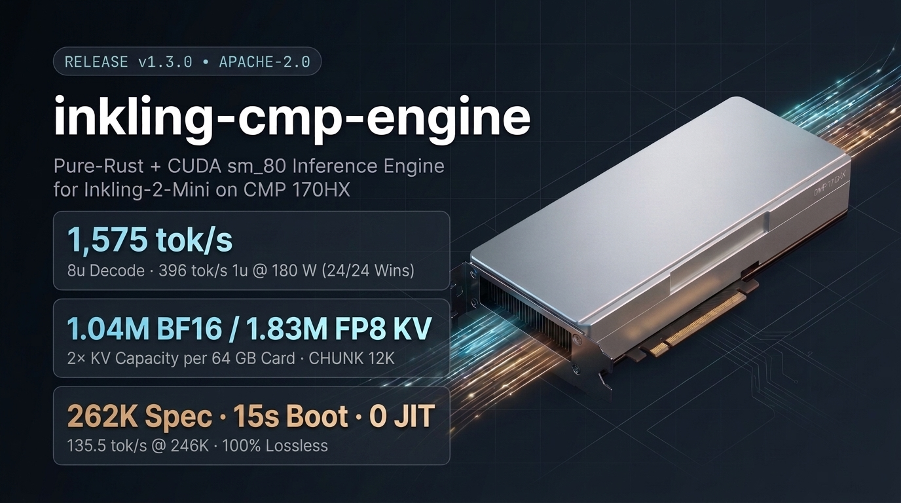
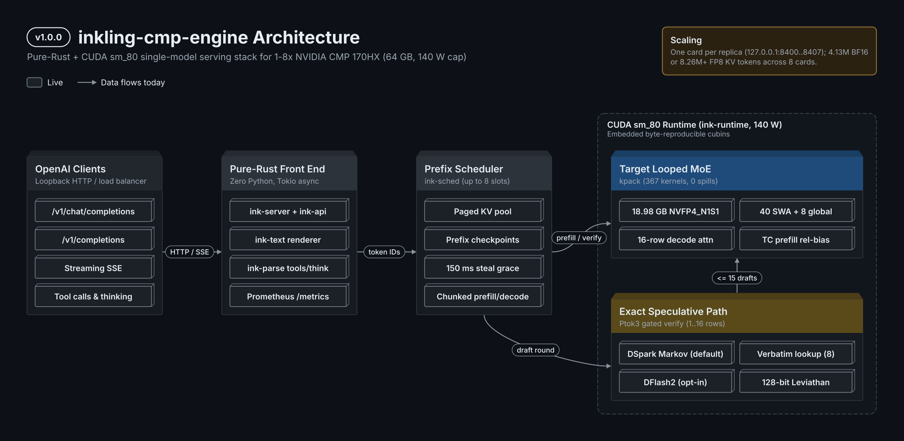

<h1 align="center">Inkling-2-Mini / NVIDIA CMP 170HX / inkling-cmp-engine</h1>

<p align="center">
  <sub>Custom pure-Rust + CUDA (<code>sm_80</code>) single-model inference engine for 1–8× CMP 170HX (64 GB)</sub>
  <br><br>
  
  
  
  
  
</p>



Serve Thinking Machines Lab's **[Inkling-2-Mini](https://huggingface.co/thinkingmachines/Inkling-2-Mini)** (looped MoE: 128 experts, top-8, native NVFP4/MXFP8 weights, GQA + SWA-1024 + 4 global layers, zero weight modification or re-quantization) on **NVIDIA CMP 170HX (GA100, `sm_80`, 64 GB HBM2e)** through a pure-Rust OpenAI-compatible API: streaming tool calls, reasoning parsing, prefix-checkpoint KV reuse, multi-prefill batching, full-context **262,144-token** pooled **DSpark** exact Leviathan speculative decoding + lossless verbatim lookup drafts, and opt-in paged **DFlash2 / DFlash2-Global** and **`--kv-fp8`**. *(The engine does not enforce a power limit — benchmarks below show 140 W production cap, 180 W apples-to-apples head-to-head, and stock 250 W.)*

> [!TIP]
> **What's new in `v1.3.0` (100% lossless, `0` diff bits, `0` new register spills):**
> - **2× BF16 KV capacity & `CHUNK=8K/12K` unlocked:** Compact `convx` commit tails (`78 MiB` fixed), decoupled 2-page persistent SWA rings + shared per-visit scratch (`pglue::swa_ring_copy_kernel`), exact arena sizing, and disjoint scratch overlays free **`8.9–32.7 GiB`** of non-KV VRAM — lifting 64 GB card capacity to **`1,015` BF16 pages (`1.04M` tokens)** with out-of-the-box `DSpark 262K` (**`996` pages / `1.02M` BF16** with `DFlash2-Global`, **`1,789` pages / `1.83M` tokens** with `--kv-fp8`, `7.0×` concurrency @ `262K`).
> - **Full `262,144`-token speculation (zero `>102.4K` cliff):** Paged E4M3 global KV for `DFlash2-Global` (`3.97 GiB` arena) and pooled E4M3 global L1 + 4K SWA rings for `DSpark` (`4.42 GiB`, `-8.1 GiB` vs `v1.2.1`) share the engine's global page table lazily — doubling long-context decode (`246K`: **`68 → 135.5 tok/s`** on `6D`, **`62 → 133.1 tok/s`** on `67` at `180 W`).
> - **Multi-prefill batching + fused decode QKV post-op:** `ink-sched` now packs multiple prefill segments per step (with a parked-KV free-page guard preserving `96%` multi-turn prefix reuse), cutting `8u` TTFT **`-45% to -51%`** (`315–350 ms → 168–207 ms`), while `fused_qkv_dec` eliminates `48` `proj_split` launches per decode step.
> - **Zero-spill pure-FAR global prefill attention + retuned Mixed GEMM pins:** Dedicated `prefill_attn_far_kernel` / `prefill_attn_fp8_far_kernel` (`0` spills, `2 CTAs/SM`) + `CHUNK=12288` deliver **`8,905–8,986 tok/s`** cold `8K` prefill, **`8,242–8,289 tok/s`** `32K`, **`6,156–6,203 tok/s`** `131K`, and **`4,723–4,768 tok/s`** `246K` at `180 W` (`~15 s` cold boot, `0` runtime JIT stalls), plus **`+8.0% to +11.7%`** on `--kv-fp8` prefill.

> [!TIP]
> **One card per replica, scales linearly to 8× CMP 170HX (`7.86M+` BF16 KV tokens / `14.6M` FP8 KV tokens across 8 cards).**
> Model weights occupy **`18.98 GB`** per card (`−1.27 GB` via 1-byte `NVFP4_N1S1` scales), leaving room for **`960` default BF16 KV pages (`983,040` tokens/card; up to `1,015` / `1.04M`)** — or **`1,728` default (`1,789` max / `1.83M`)** with opt-in [`--kv-fp8`](#kv-fp8-opt-in).

**Who wrote what.** This engine (`engine/rust/` + `engine/kernels/`) was built for batched multi-session `sm_80` serving, standing directly on ideas, kernels, protocols, and tooling from the open-source inference community: [Thinking Machines Lab](https://huggingface.co/thinkingmachines/Inkling-2-Mini) (Inkling-2-Mini architecture, NVFP4/MXFP8 weights, DSpark drafter), [Inco AI](https://huggingface.co/incoai/Inkling-2-Mini-DFlash2) (DFlash2 parallel drafter), **[Mia's AI Lab (`@MiaAI_lab`)](https://github.com/MiaAI-Lab)** (MiaAI-Lab decode/prefill benchmark protocol, setup UX, and recipe conventions), **[0xSero / Sybil Solutions](https://github.com/sybil-solutions/inference-optimisation-skill)** (`inference-optimisation-skill` ceiling-first hill-climbing methodology and qualification discipline), [satellitedown (`ingine` / `fngine` / `Cinference`)](https://github.com/satellitedown/inkling-2-mini-abliterated-ingine) & [Neroued (`NInfer`)](https://github.com/Neroued/ninfer), [alesha-pro (`maya-inkling-mini`)](https://github.com/alesha-pro/maya-inkling-mini), **[Morrowmake (`vllm-cmp170hx`)](https://github.com/Morrowmake/vllm-cmp170hx)**, **[snailbrainx (`inkling-2-mini-sm80`)](https://github.com/snailbrainx/inkling-2-mini-sm80)** & the CMP 170HX unlock community (`amoghmunikote`, `kate-land`, `it-still-boots`), and vLLM / Humming. Full list: [Credits](#credits) and [`NOTICE`](NOTICE).

- **Checkpoint:** `thinkingmachines/Inkling-2-Mini` @ `ed40e7da` (native NVFP4 layers 0–19, MXFP8 layers 20–23, `18.98 GB` on GPU; weights mounted read-only and never modified)
- **API:** OpenAI-compatible `/v1/chat/completions`, `/v1/completions`, `/v1/models`, `/health`, `/metrics`; model id `inkling-2-mini`; loopback ports `127.0.0.1:8400..8407`
- **Engine:** Pure-Rust host stack (`ink-server`, `ink-sched`, `ink-runtime`, `ink-kernels`, `ink-tools`) + embedded byte-reproducible CUDA `sm_80` kernel pack (`393` kernels, `0` new spills)
- **License:** [Apache License 2.0](LICENSE)

## Contents

- [Performance](#performance)
- [Lossless verification](#lossless-verification)
- [Requirements](#requirements)
- [Quick start](#quick-start)
- [`--kv-fp8` (opt-in)](#kv-fp8-opt-in)
- [`--draft-dflash2` (opt-in)](#draft-dflash2-opt-in)
- [Architecture & key optimizations](#architecture--key-optimizations)
- [Configuration](#configuration)
- [Building without Docker](#building-without-docker)
- [Repository layout](#repository-layout)
- [Credits](#credits)

## Performance

Measured on **1× NVIDIA CMP 170HX** (`6D` vBIOS: 1,728 MHz HBM, and `67` vBIOS: 1,458 MHz HBM) across three reference regimes:
1. **`180 W` apples-to-apples head-to-head (`v1.3.0`)** on the exact same `6D` and `67` cards back-to-back against [`snailbrainx/inkling-2-mini-sm80 v3`](https://github.com/snailbrainx/inkling-2-mini-sm80) (`vLLM` + Humming + `CONV_TAIL=1`, `BATCH=12288`, `DSpark K=4`), showing both **out-of-the-box `DSpark 262K`** (`944` BF16 pages = `967K` tok) and **Stage-3 `DFlash2-Global (s3_l13)`** (`928` BF16 pages = `950K` tok).
2. **`140 W` production cap** (`v1.3.0` canonical M1 multi-turn agent replay at `960` BF16 pages = `983K` tok, `CHUNK=8192`, `262K` speculation, and `v1.0–v1.1` vs vLLM Config B).
3. **Stock `250 W`** (`v1.0.0` reference numbers).

### 1. `180 W` Apples-to-Apples Head-to-Head (`v1.3.0` vs `snailbrainx-sm80 v3`, Same Cards)

Identical HTTP streaming client, identical MiaAI-Lab prompts (`T=0`, `400` tok/user, `reasoning_effort=none`, median of 5 runs at `1u` and 3 runs at `2/4/8u`), identical `8K / 32K / 131K / 246K` cold prompts (`cached=0`, `256`-tok gen), matched cold starts (`35–48 °C`), `180.00 W` cap.

| Axis | `v1.3.0` (`DSpark` out-of-the-box) | **`v1.3.0` (`DFlash2-Global s3_l13`)** | `snailbrainx-sm80 v3` (`vLLM`) |
|---|---|---|---|
| Max BF16 KV (64 GB, `8` slots) | **`1,039,360` tok** (`8K`) / `996,352` (`12K`) | **`1,019,904` tok** (`8K`) / `979,968` (`12K`) | `705,878` tok (`CONV_TAIL=1`) |
| Max `--kv-fp8` KV (64 GB) | — | **`1,831,936` tok** (`7.0×` @ `262K`) | N/A |
| Cold boot to `/health` | **`~15 s`** (`0` runtime JIT stalls) | **`~15 s`** (`0` runtime JIT stalls) | `172 s` (`4` runtime Triton/FlashInfer JIT stalls) |
| Speculation range | **`262,144` tok** (pooled E4M3) | **`262,144` tok** (paged E4M3) | `262,144` tok |

#### MiaAI-Lab Decode Matrix — `180 W` (`6D` / `67`, aggregate tok/s & median TTFT)

With `DFlash2-Global (s3_l13)`, **`v1.3.0` wins `24/24` throughput cells (`+6.3%` to `+40.7%`) AND `24/24` TTFT cells** across both `6D` and `67`. Out-of-the-box `v1.3.0 DSpark` cuts `8u` TTFT to `168–207 ms` (vs `192–288 ms`), beats `sbx-v3` on `1u/2u/4u` lists (`+7.8%` to `+20.5%`), `2u` code (`+14.4%` to `+16.3%`), and `67` `8u` lists (`1,394.6` vs `1,227.0`, `+13.7%`), and brings `1.04M` BF16 KV tokens with zero extra checkpoints.

| Cell (`T=0`, `400` tok/u) | **`v1.3.0 s3_l13` (`6D` / `67`)** | `v1.3.0 DSpark` (`6D` / `67`) | `sbx-v3` (`6D` / `67`) | `v1.3 s3_l13` Δ vs `sbx-v3` | TTFT `v1.3` vs `sbx-v3` (`6D`) |
|---|---:|---:|---:|---:|---:|
| **`1u` lists** | **`396.0` / `376.8`** *(dec `418.8` / `397.6`)* | `378.0` / `354.5` | `337.8` / `329.0` | **`+17.2%` / `+14.5%`** | **`56 ms`** vs `58 ms` |
| **`1u` code** | **`250.0` / `246.7`** *(dec `259.9` / `256.4`)* | `216.2` / `214.3` | `235.1` / `208.9` | **`+6.3%` / `+18.1%`** | **`62 ms`** vs `118 ms` |
| **`1u` prose** | **`214.7` / `203.2`** *(dec `221.2` / `209.2`)* | `168.2` / `164.0` | `179.3` / `165.7` | **`+19.7%` / `+22.7%`** | **`58 ms`** vs `120 ms` |
| **`2u` lists** | **`637.6` / `630.6`** *(dec `714.5` / `704.1`)* | `603.6` / `583.1` | `513.8` / `483.9` | **`+24.1%` / `+30.3%`** | **`108 ms`** vs `170 ms` |
| **`2u` code** | **`385.9` / `405.8`** *(dec `454.1` / `462.1`)* | **`410.6`** / `380.6` | `353.0` / `332.7` | **`+9.3%` / `+22.0%`** | **`118 ms`** vs `235 ms` |
| **`2u` prose** | **`358.9` / `325.0`** *(dec `380.1` / `370.4`)* | `284.8` / `273.3` | `288.0` / `272.9` | **`+24.6%` / `+19.1%`** | **`114 ms`** vs `215 ms` |
| **`4u` lists** | **`1,081.8` / `1,031.9`** *(dec `1,231` / `1,165`)* | `925.6` / `911.4` | `768.9` / `785.8` | **`+40.7%` / `+31.3%`** | **`132 ms`** vs `180 ms` |
| **`4u` code** | **`608.2` / `561.8`** *(dec `697.7` / `680.1`)* | `470.5` / `461.6` | `479.1` / `467.1` | **`+26.9%` / `+20.3%`** | **`154 ms`** vs `268 ms` |
| **`4u` prose** | **`577.6` / `528.6`** *(dec `632.7` / `581.9`)* | `411.4` / `404.9` | `445.5` / `451.7` | **`+29.6%` / `+17.0%`** | **`142 ms`** vs `241 ms` |
| **`8u` lists** | **`1,559.5` / `1,575.3`** *(dec `1,801` / `1,823`)* | `1,308.1` / `1,394.6` | `1,321.6` / `1,227.0` | **`+18.0%` / `+28.4%`** | **`169 ms`** vs `192 ms` |
| **`8u` code** | **`852.9` / `822.3`** *(dec `1,086` / `1,041`)* | `704.1` / `712.3` | `695.2` / `728.7` | **`+22.7%` / `+12.8%`** | **`203 ms`** vs `288 ms` |
| **`8u` prose** | **`835.7` / `834.9`** *(dec `938.8` / `919.7`)* | `639.9` / `629.4` | `697.5` / `704.4` | **`+19.8%` / `+18.5%`** | **`186 ms`** vs `262 ms` |
| **`RAND1K` `T=0.7` (`1/2/4/8u`, `6D`)** | **`175 / 286 / 343 / 481`** | `188 / 229 / 326 / 418` | `163 / 150* / 214* / 472` | **4/4 wins** | `0` JIT stalls |

#### Cold Prefill & Long-Context Decode — `180 W` (`8K / 32K / 131K / 246K`, `cached=0`, `CHUNK=12288`)

| Prompt (`T`) | `v1.3.0 s3_l13` (`6D` / `67`, pf · dec) | `v1.3.0 DSpark` (`6D` / `67`, pf · dec) | `sbx-v3` (`6D` / `67`, pf · dec) | `v1.2.1` (`6D` / `67`, pf · dec) |
|---:|---:|---:|---:|---:|
| **`8,192`** (`0.0`) | **`8,905` / `8,892`** · **`213.0`** / `181.1` | `8,833` / **`8,986`** · `207.8` / `194.1` | `8,470` / `8,557` · `203.8` / `202.6` | `8,493` / `8,473` · `201.7` / `170.2` |
| **`32,750`** (`0.0`) | **`8,242` / `8,285`** · `183.2` / `178.1` | **`8,246` / `8,286`** · `161.6` / `156.8` | `3,693*` / `3,718*` · `238.5` / `199.3` | `7,974` / `7,995` · `169.0` / `154.8` |
| **`32,734`** (`0.7`) | `8,254` / `8,267` · **`230.4`** / `206.6` | `8,250` / `8,289` · `158.6` / `167.9` | `8,260` / `8,363` · `197.1` / `213.8` | `7,967` / `7,981` · `178.7` / `160.9` |
| **`131,016`** (`0.0`) | **`6,163` / `6,203`** · `148.6` / `146.6` | `6,157` / `6,198` · `149.3` / `162.7` | `4,226*` / `4,244*` · `166.5` / `181.2` | `5,909` / `5,924` · `79.7†` / `75.2†` |
| **`131,045`** (`0.7`) | `6,156` / `6,194` · `146.8` / `150.7` | `6,154` / `6,193` · `134.1` / `134.7` | `6,238` / `6,292` · `168.8` / `154.0` | `5,891` / `5,912` · `78.9†` / `74.6†` |
| **`246,393`** (`0.0`) | `4,723` / `4,758` · **`135.5`** / `120.0` | `4,723` / `4,768` · `127.4` / **`133.1`** | `4,769` / `4,805` · `132.6` / `131.7` | `4,506` / `4,526` · `68.0†` / `61.7†` |

`*` First-hit Triton/FlashInfer JIT compilation stall in `sbx-v3` (`+4.9 s` at `32K`, `+10.0 s` at `131K`). `†` `v1.2.1` capped `--draft-ctx 102400`.

### 2. Realistic Multi-Turn Agent Workload (M1 Replay, `~45K` median context)

343 multi-turn agent requests (`118,056` output tokens, `~12.6M` prompt tokens, `~96%` prefix-cached, `0` errors) on `6D` (self-fed history) and `67` (recorded history). At `140 W`, **`v1.3.0`** runs **`960` BF16 KV pages (`983K` tok)**, `CHUNK=8192`, `262K` speculation, and `--lookup 8` — lifting `N=4 T=0` to **`385.4 tok/s`** (`6D`) and `N=8 T=1.0` to **`384.7–386.3 tok/s`** (`6D`) while slashing `N=8` TTFT p99 **`−24%` to `−26%`** (`5.61 → 4.26 s` on `6D`, `5.19 → 3.82 s` on `67`). Full hill-climb ledger in [`docs/LEDGER.md`](docs/LEDGER.md).

| Card / Workload | **140 W M1 `v1.3.0`** (`960` BF16 pg, `262K`, TTFT p99) | **250 W M1** (`v1.0.0`, TTFT p99) | Config B @ 140 W | `v1.3` 140 W vs Config B |
|---|---:|---:|---:|---:|
| **`6D` card · `N=4, T=0`** (self-fed) | **`385.4 tok/s`** `s3_l13` (`2.95 s`) / `383.3` `DSpark` | `493.0 tok/s` (`2.15 s`) | `303.1 tok/s` (`6.61 s`) | **`+27.2%`** |
| **`6D` card · `N=8, T=1.0`** (self-fed) | **`386.3 tok/s`** `DSpark` (`4.73 s`) / **`384.7`** `s3_l13` (`4.26 s`) | `483.7 tok/s` (`5.60 s`) | `287.8 tok/s` | **`+34.2%`** |
| **`67` card · `N=4, T=0`** (recorded) | **`356.9 tok/s`** `s3_l13` (`2.19 s`) / `353.9` `DSpark` | `435.8 tok/s` (`2.70 s`) | `293.8 tok/s` (`4.98 s`) | **`+21.5%`** |
| **`67` card · `N=8, T=1.0`** (recorded) | **`368.8 tok/s`** `DSpark` (`3.82 s`) / `358.5` `s3_l13` (`4.55 s`) | `444.4 tok/s` (`5.34 s`) | `301.2 tok/s` | **`+22.4%`** |

### 3. Stock `250 W` Reference (MiaAI-Lab Decode & Cold Prefill, `v1.0.0` DSpark)

At uncapped `250 W`, SM clocks lift from `~1,050 MHz` (`140 W`) to `~1,390 MHz` (and `v1.3.0` adds `CHUNK=12288`, zero-spill FAR prefill, multi-prefill batching, and `262K` speculation on top). `v1.0.0` 250 W reference points (`6D` / `67`): `1u` structured **`435.1 / 393.4`**, `1u` code **`272.2 / 247.3`**, `4u` structured **`921.8 / 869.6`**, `8u` structured **`1,323.2 / 1,276.1 tok/s`**; cold prefill `4K` **`9,455`**, `8K` **`9,196`**, `32K` **`8,360`**, `120K` **`6,378 tok/s`**.

## Lossless verification

Every optimization in `v1.3.0` (`kpack 46748cf1c41d`, `393` launchers, `0` new register spills) passed the full lossless verification suite:

- **Kernel pack & SASS integrity (`E0`):** `385/390` unchanged kernels have **100% bit-identical SASS** vs `v1.2.1`; **`0` new register spills** across all new/updated kernels (`prefill_attn_far`, `prefill_attn_fp8_far`, `swa_ring_copy`, paged `DFlash2-Global`, pooled `DSpark`).
- **Batch, chunk & multi-prefill invariance (`ink-inv`):** **`0` differing bits** across BF16 `--max-chunk 8192` & `12288` and FP8 `--kv-fp8 --max-chunk 12288` (`0` GEMM fallbacks, `0` reply-reuse failures), including `multi_prefill_vs_single`, `resume_vs_cold`, and 16-row `verify_rows16_vs_decode`.
- **Config B full-envelope KL gate (`ink-gold` + `compare.py band`, 4,072 positions / 47 cases + 20 greedy):** **PASS** — mean KL **`0.00477`** (`se 0.00046 <= 0.00535`, tighter than Config B's own `all-chunk8k` `0.00489`), top-1 **`98.04%`** (`>= 97.53%`), max KL **`0.4234`** (`<= 2.1742`), greedy **`0/20` fail**.
- **Speculative path equivalence & exact Leviathan distribution (`ink-spec`, `--draft-ctx 262144 --lookup 8`):**
  - **Paged `DFlash2-Global (s3_l13)`:** greedy **`0/8,000` bad argmax** (`max_gap 0.0000`, **`4.020 tok/rd`**); sampled **`20/20` equal** (`8,000/8,000`, `flags_or=0`); `sdist` **`13/13` PASS** (`212,992` draws, **`0` zero-probability draws**); `246K` page-boundary rollback test **PASS** (bit-identical).
  - **Pooled E4M3 `DSpark 262K`:** greedy **`0/8,000` bad argmax** (`max_gap 0.0000`, **`3.136 tok/rd`**); sampled **`20/20` equal** (`8,000/8,000`, `flags_or=0`, `2.973 tok/rd`); `sdist` **`5/5` PASS** (`81,920` draws, **`0` zero-probability draws**); `246K` page-boundary rollback test **PASS**.
- **Host/scheduler suite:** clean build, `cargo clippy --locked --workspace --all-targets -- -D warnings`, `cargo fmt --check`, and all unit/property/replay tests pass (including 36/36 `ink-sched` multi-prefill + parked-KV tests).

## Requirements

- **GPU:** 1–8× NVIDIA CMP 170HX (64 GB unlocked, `sm_80`, GA100; works on other 64–80 GB `sm_80` GPUs such as A100 as well) with a CUDA 13-capable NVIDIA driver.
- **Container runtime:** Docker with the [NVIDIA Container Toolkit](https://docs.nvidia.com/datacenter/cloud-native/container-toolkit/latest/install-guide.html).
- **Disk & one-time prep:** ~25 GB free for `thinkingmachines/Inkling-2-Mini` (`model-00001-of-00001.safetensors` + `mtp.safetensors`) + ~150 MB for folded DSpark weights (`fold.bin`, `lowrank16.bin`). One-time weight folding requires Python with `torch` and `safetensors` (`pip install torch safetensors huggingface-hub`).

## Quick start

```bash
git clone https://github.com/shanedertrain/inkling-cmp-engine.git
cd inkling-cmp-engine
cp scripts/local.sh.example scripts/local.sh
```

Edit `scripts/local.sh` to set `GPUS` (e.g. `GPUS="0"` for one card or `GPUS="0 1 2 3 4 5 6 7"` for eight cards) and `MODEL_DIR` if you already downloaded `thinkingmachines/Inkling-2-Mini`. Then run:

```bash
./start.sh
```

The first run builds the CUDA + Rust Docker image (`Dockerfile`), downloads `thinkingmachines/Inkling-2-Mini` if missing, folds the DSpark drafter head (`scripts/fold-dspark.py`), compiles the `sm_80` kernel pack and `ink-server`, starts one replica per GPU on `127.0.0.1:8400..8407` with **`960` BF16 KV pages (`983K` tok), `CHUNK=8192`, `262K` speculation, and `--lookup 8`**, waits for `/health` (auto-tuning `gemm-algos.json` on first boot), and runs a smoke completion. Later runs start in **~15 seconds** with zero runtime JIT stalls.

Test an endpoint:

```bash
curl -s http://127.0.0.1:8400/v1/chat/completions \
  -H 'content-type: application/json' \
  -d '{"model":"inkling-2-mini","messages":[{"role":"user","content":"Hello!"}],"max_tokens":64}'
```

Manage replicas:

```bash
./status.sh                 # check health of all configured GPU replicas
./start.sh restart          # restart with updated scripts/local.sh or env flags
./stop.sh                   # stop all running replicas
```

## `--kv-fp8` (opt-in)


`KV_FP8=1 ./start.sh restart` (or `KV_FP8=1` in `scripts/local.sh`, off by default) passes `--kv-fp8` to store the **8 global long-context attention layers' KV pool in 1-byte FP8 (`E4M3FN`)** while keeping the 40 sliding-window (SWA-1024) rings in BF16. Default BF16 mode is bit-identical and untouched when omitted.

- **Pros:**
  - **`~1.8×` KV cache capacity** on top of `v1.3.0`'s VRAM diet: **`1,728` default / `1,789` max pages (`1.83M` cached tokens/card, `7.0×` @ `262K`)** — `14.6M` KV tokens across an 8-card node.
  - **Faster deep-context decode & `v1.3.0` FP8 FAR prefill:** `4×8 120K` decode drops **`−16.6%`**, `8×8 45K` `−6.0%`, and `v1.3.0`'s zero-spill `prefill_attn_fp8_far_kernel` lifts `131K / 246K` FP8 prefill **`+8.0%` to `+11.7%`**.
  - **Still batch/chunk-invariant:** `ink-inv --kv-fp8 --max-chunk 12288` passes with **`0` differing bits**.
- **Cons (labelled lossy switch):**
  - Increases 4,911-position mean KL (`0.0048 → 0.0262`, top-1 `97.45%`, `9/20` greedy shifts).
  - **When to use it:** for extreme KV-capacity-bound `262K` multi-session pools (`>1M` tokens/card); default lossless BF16 already holds `1.04M` tokens/card in `v1.3.0`.

## `--draft-dflash2` (opt-in)

Set `DFLASH2_DIR=/path/to/Inkling-2-Mini-DFlash2` in `scripts/local.sh` (or pass `--draft-dflash2 <dir>` to `ink-server`) to use [Inco AI's Inkling-2-Mini-DFlash2](https://huggingface.co/incoai/Inkling-2-Mini-DFlash2) or a custom hybrid global-attention `DFlash2-Global` checkpoint (5-layer parallel diffusion-style drafter, Tensor Core MMA SWA-2048 ring buffer, W8A16 head, 16-warp bilinear selector walk, exact Leviathan rejection sampling, and Ptok3 `conf` gating at `tau = 0.25`) instead of DSpark:

- **Paged `262K` E4M3 global KV (`v1.3.0`):** `RustDFlash2` shares the engine's `1,024`-token global page table lazily via `page_gen()` (`COS_SIN_POS = 262,208`), shrinking `s3_l13` (`2` global layers) from `8.86 GiB` linear to **`3.97 GiB` total arena** (`504` pages) and unlocking **`996` BF16 KV pages (`1.02M` tokens)** or **`1,789` FP8 pages (`1.83M` tokens)** with zero `>102.4K` speculation cliff (`3.35 ms` draft step at `k=1, 246K`).
- **Benchmarks (`180 W` & `140 W`, 100% lossless):** With Stage-3 selector-calibrated + stock-anchored `DFlash2-Global (s3_l13)`, `v1.3.0` reaches **`396.0 / 250.0 / 214.7 tok/s`** (`1u`), **`1,081.8 / 608.2 / 577.6 tok/s`** (`4u`), **`1,575.3 / 852.9 / 835.7 tok/s`** (`8u`), and **`135.5 tok/s`** at `246K` (`180 W`), plus **`532.89 tok/s`** (`5.592 tok/rd`, `+28.3%` vs DSpark) on `4×45K` `tf-agent-120k` at `140 W`.
- **Target-tap extractor (`ink-taps`):** Included in `ink-tools` to extract native `[5, 23, 41, 48]` BF16 target features at `~6K tok/s` per GPU for distilling custom lossless drafters.

## Architecture & key optimizations




- **VRAM diet & `CHUNK=8K/12K` unlock (`v1.3.0`):** Compact `convx` commit-tail buffer (`78 MiB` fixed vs `2.64–10.23 GiB`), decoupled 2-page persistent SWA rings + shared per-visit scratch (`pglue::swa_ring_copy_kernel`, `-2.50` to `-13.75 GiB`), tightened `WEIGHTS_BYTES_ESTIMATE` (`19.05 GB`), exact `ArenaPlan::used()` sizing, and 4 lifetime-disjoint scratch overlays — freeing `8.9–32.7 GiB` and doubling BF16 KV capacity to **`1.04M` tokens/card** (`1.83M` FP8) at `CHUNK=8K/12K`.
- **Multi-prefill batching & fused decode QKV post-op (`v1.3.0`):** `ink-sched` packs multiple prefill segments per step (guarded by a free-page check that never evicts parked prefix-cache sessions), cutting `8u` TTFT **`−45%` to `−51%`** (`315–350 ms → 168–207 ms`), while `fused_qkv_dec` eliminates `48` `proj_split` kernel launches per decode step (`0` diff bits).
- **Full `262K` paged/pooled drafter KV (`v1.3.0`):** `RustDFlash2` (`1,024`-tok paged E4M3 global KV) and `RustDrafter` / DSpark (pooled E4M3 global L1 + fixed `4K` SWA rings for L0/L2) share `Engine::slots` page tables lazily via `page_gen()`, cutting drafter VRAM by `6.7–8.5 GiB` and eliminating the `>102.4K` cliff.
- **Zero-spill pure-FAR global prefill attention & retuned Mixed GEMM pins (`v1.3.0`):** Partitions global prefill items into pure-FAR (distance `>= 1,024`, unmasked, no relative bias) and NEAR; dedicated `prefill_attn_far_kernel` / `prefill_attn_fp8_far_kernel` (`0` spills, `2 CTAs/SM`) + 4 retuned Mixed cuBLASLt pins win `32/32` BF16 cells (`+1.2%` to `+3.7%` on top of `CHUNK=12K`) and **`+8.0%` to `+11.7%`** on `--kv-fp8` prefill.
- **Dedicated decode MoE + 1-byte `NVFP4_N1S1` scales:** `pmoe::moe_gemm_dec<FMT, MODE, 5, 4>` (`BN_DEC=16`, `ldmatrix.x2` for `NT=1`, 5 stages, `0` spills) + 1-byte native E4M3 scales save **`1.27 GB` VRAM** and cut decode MoE `−18%` without altering weights.
- **Single-pass 1..16-row decode attention + lossless verbatim lookup drafts (`MAX_CHAIN=32`):** `decode_attn_kernel16<KV>` + 6-warp SWA ring kernel + Ptok3-gated longest-back n-gram lookup (`--lookup 8 --lookup-min 8`), with `PGLUE_ROWS=128` + `MT=8` decode router/gate kernels eliminating the `N=8 T=65..128` cliff.
- **In-kernel Tensor Core prefill relative bias + virtual messages:** Eliminates `10.3 GB/chunk` `relk` HBM traffic in `prefill_attn` and `~87 GB/32K` of `msgs` HBM traffic via `vmsg_weights_kernel` (`7.50×`), plus fused multi-query AttnRes and `__match_any_sync` `moe_build`.
- **Zero-stall spec round & prefix-preserving scheduler:** Cached `CUgraphExec` kernel-node retargeting, coalesced 1-sync `verify_widths_and_drafts`, exact 128-bit Leviathan rejection/residual sampling, and exact resume + slot rollback checkpoints with `slot_steal_grace_ms = 150 ms`.

## Configuration

Key `ink-server` flags (and `scripts/local.sh` / environment overrides):

| Flag / Env | Default (`v1.3.0`) | Purpose |
|---|---|---|
| `--slots` / `SLOTS` | `8` | Active + parked KV/ring slots (`acquire_slot` protects freshly-parked long prefixes) |
| `--kv-pages` / `PAGES` | `960` (`1728` w/ FP8) | 1,024-token global KV pages (`983K` / `1.77M` default; max `1,015` / `1,789`) |
| `--prefill-chunk` / `CHUNK` | `8192` (`12288` peak prefill) | Max prefill chunk rows per step (`start.sh` default `8192`) |
| `--max-running` / `MAX_RUNNING` | `8` | Max concurrent active sessions per card |
| `--draft-ctx` / `DCTX` | `262144` | Max speculation context (full `262K` via pooled E4M3 DSpark / paged DFlash2-Global) |
| `--lookup` / `LOOKUP` | `8` | Lossless verbatim n-gram lookup drafts appended to drafter (`0` disables) |
| `--verify-call-rows` | `1,2,3,4,6,8,10,12,14,16` | Ptok3 confidence-gated verify widths |
| `--kv-fp8` / `KV_FP8=1` | off (`false`) | Opt-in global E4M3 KV cache (`1.83M` max tok/card, lossy) |
| `--draft-dflash2` / `DFLASH2_DIR` | off | Opt-in Inco AI DFlash2 / DFlash2-Global parallel drafter |

## Building without Docker

If you have CUDA 13.x (`nvcc`) and Rust 1.98+ installed natively on Linux:

```bash
# 1. Fold DSpark weights once from thinkingmachines/Inkling-2-Mini
python3 scripts/fold-dspark.py --model-dir /path/to/Inkling-2-Mini --out-dir build/dspark-fold

# 2. Build the sm_80 kernel pack and sync ink-kernels bindings
./engine/kernels/pack/regen.sh build/kpack

# 3. Build ink-server and ink-tools with embedded cubins
cd engine/rust
INK_KPACK_DIR="$PWD/../../build/kpack" cargo build --release --locked -p ink-server -p ink-tools

# 4. Run tests, clippy, and rustfmt
./scripts/check.sh
```

## Repository layout

- `start.sh`, `stop.sh`, `status.sh`, `Dockerfile`, `scripts/` — Mia-style one-command setup, DSpark weight folder (`fold-dspark.py`), and multi-GPU replica scripts.
- `engine/rust/` — Pure-Rust workspace (`ink-server`, `ink-api`, `ink-text`, `ink-parse`, `ink-backend`, `ink-sched`, `ink-runtime`, `ink-cuda`, `ink-kernels`, `ink-model`, `ink-rt-api`, `ink-record`, `ink-tools`, `xtask`).
- `engine/kernels/` — CUDA `sm_80` kernels (`decode_attn/`, `prefill_attn/`, `prefill_moe/`, `glue/`, `drafter/`, `dflash2/`, `sample/`, `pack/`).
- `engine/tools/bench/` — MiaAI-Lab decode/prefill benchmark harness (`mia_bench.py`) and summary helpers.
- `docs/` — [`LEDGER.md`](docs/LEDGER.md) (hill-climb ledger), [`BASELINE.md`](docs/BASELINE.md) (Config B baseline), [`engine/configB-numerics.md`](docs/engine/configB-numerics.md), [`ampere/SOURCES.md`](docs/ampere/SOURCES.md), and `diagrams/` (`open-diagram` sources + SVG/PNG).

## Credits

This engine stands on the shoulders of many open-source projects, researchers, and hardware hackers whose ideas, architectures, kernels, protocols, and benchmarks directly shaped our design:

- **Thinking Machines Lab** — [Inkling-2-Mini](https://huggingface.co/thinkingmachines/Inkling-2-Mini) (Apache-2.0; looped MoE architecture, NVFP4/MXFP8 weights, DSpark Markov speculative drafter) and `TML-d24-varloop-research`.
- **Inco AI** — [Inkling-2-Mini-DFlash2](https://huggingface.co/incoai/Inkling-2-Mini-DFlash2) (parallel diffusion-style 5-layer speculative drafter, dynamic grouped convolutions, and rank-256 bilinear candidate selector), implemented natively here in Rust + CUDA.
- **Mia's AI Lab (`@MiaAI_lab`)** — [MiaAI-Lab](https://github.com/MiaAI-Lab) ([DeepSeek-V4.1-Flash-1017-4x-DGX-Sparks-TensorFold](https://github.com/MiaAI-Lab/DeepSeek-V4.1-Flash-1017-4x-DGX-Sparks-TensorFold) and related open-source inference recipes), whose structured / code / prose decode & prefill benchmark protocol, prompt suite, one-command `local.sh` + `start.sh` setup conventions, and README presentation directly shaped this release.
- **0xSero & Sybil Solutions** — [0xSero](https://github.com/0xSero) and [sybil-solutions/inference-optimisation-skill](https://github.com/sybil-solutions/inference-optimisation-skill), whose ceiling-first inference optimization methodology, noise-controlled A/B experiment ledger, and lossless qualification workflow guided the entire hill-climb.
- **satellitedown (`ingine`, `fngine`, `Cinference`) & Neroued (`NInfer`)** — [ingine](https://github.com/satellitedown/inkling-2-mini-abliterated-ingine) (Apache-2.0), [fngine](https://github.com/satellitedown/fngine), [Cinference](https://github.com/satellitedown/cinference), and [NInfer](https://github.com/Neroued/ninfer). `ingine`'s kernel contracts, fused decode graph layout, prefix checkpoint parking, FP64/golden qualification methodology, and zero-Python server architecture directly inspired our engine design.
- **alesha-pro (`maya-inkling-mini`)** — [maya-inkling-mini](https://github.com/alesha-pro/maya-inkling-mini) (MIT), the Ampere (`sm_86`) Inkling-2-Mini engine reference for register-level NVFP4-to-Tensor-Core decoding, full-step CUDA graphs, and verify-block attention.
- **Morrowmake & CMP 170HX community (`amoghmunikote`, `kate-land`, `it-still-boots`, `snailbrainx`)** — [vllm-cmp170hx](https://github.com/Morrowmake/vllm-cmp170hx) (Apache-2.0), [inkling-2-mini-sm80](https://github.com/snailbrainx/inkling-2-mini-sm80) (Apache-2.0 `sm_80` vLLM port whose `180 W` `CONV_TAIL` + `BATCH=12288` head-to-head sparked our `v1.2.1` and `v1.3.0` sprints), [cmpunlocker](https://github.com/amoghmunikote/cmpunlocker), [ga100vfi](https://github.com/kate-land/ga100vfi), and [cmp-170hx-docs](https://it-still-boots.github.io/cmp-170hx-docs/), whose CMP 170HX hardware bring-up, unlock work, and `sm_80` vLLM patches made running these cards possible.
- **vLLM & Humming** — [vLLM](https://github.com/vllm-project/vllm) (Apache-2.0), PagedAttention ([Kwon et al., 2023](https://arxiv.org/abs/2309.06180)), [Humming](https://github.com/vllm-project/humming) NVFP4/MXFP8 Ampere MoE kernels (Apache-2.0), and OpenAI-compatible serving/metrics semantics used as our Config B baseline and parity reference.
- **Speculative Decoding Research:**
  - **Leviathan, Kalman, and Matias (2022)** — *Fast Inference from Transformers via Speculative Decoding* ([arXiv:2211.17192](https://arxiv.org/abs/2211.17192)) and **Chen et al. (2023)** — exact lossless rejection + residual sampling used in both our DSpark and DFlash2 Leviathan samplers.
  - **EAGLE / EAGLE-2** ([Li et al., 2024](https://arxiv.org/abs/2406.16858)), **Medusa**, **SpecInfer**, **Sequoia**, and **Prompt Lookup Decoding** — speculative drafting, verbatim n-gram lookup, and confidence-gated verification concepts.
  - **SqueezeAILab & contributors (`minseo25`)** — [2DSD](https://github.com/SqueezeAILab/2DSD) (2D Speculative Decoding for variable-loop models), evaluated during architecture scouting.
- **GPU Kernel & Serving References** (full bibliography in [`docs/ampere/SOURCES.md`](docs/ampere/SOURCES.md)):
  - **FlashAttention / FlashAttention-2** ([Dao et al.](https://github.com/Dao-AILab/flash-attention)), **Flash-Decoding** (Stanford CRFM), and **FlashInfer** ([Ye et al.](https://github.com/flashinfer-ai/flashinfer)).
  - **Marlin** ([IST-DASLab](https://github.com/IST-DASLab/marlin)), **NVIDIA CUTLASS / FasterTransformer / TensorRT-LLM**, **QServe / AWQ** (MIT Han Lab), **FLUTE**, **BitBLAS**, **SGLang**, **llama.cpp**, **ExLlamaV2 / ExLlamaV3** (`turboderp-org`), **ThunderKittens & Megakernels** (Stanford Hazy Research), and **Mirage**.
- **Hugging Face Transformers community** — [PR #51161](https://github.com/huggingface/transformers/pull/51161) (`last_loop` KV cache sharing proposal, evaluated during exploration).

## License

Licensed under the [Apache License, Version 2.0](LICENSE). Upstream attributions and adapted file notices are recorded in [`NOTICE`](NOTICE).
