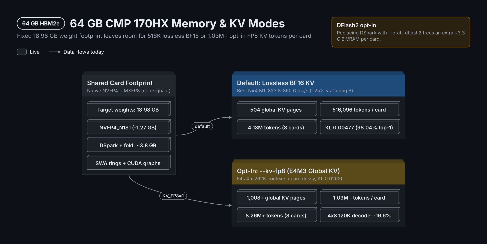
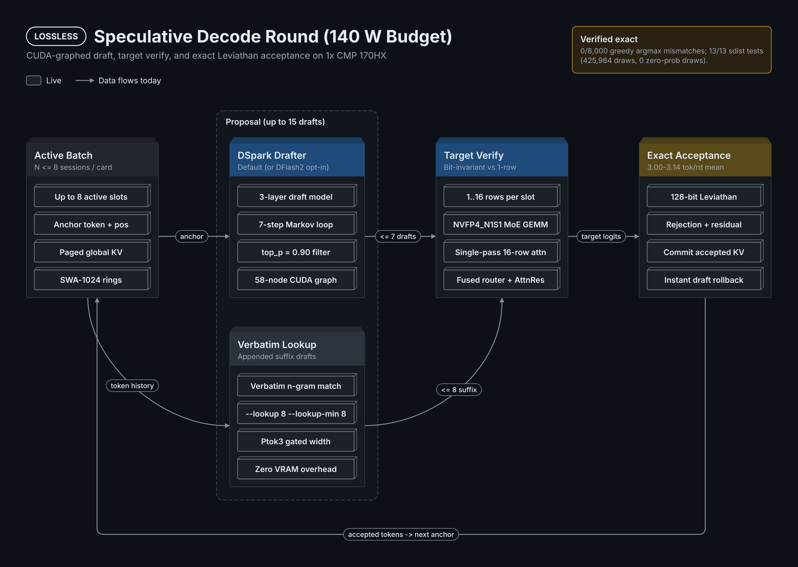

<h1 align="center">Inkling-2-Mini / NVIDIA CMP 170HX / inkling-cmp-engine</h1>

<p align="center">
  <sub>Custom pure-Rust + CUDA (<code>sm_80</code>) single-model inference engine for 1–8× CMP 170HX (64 GB, 140 W cap)</sub>
  <br><br>
  
  
  
  
  
</p>


Serve Thinking Machines Lab's **[Inkling-2-Mini](https://huggingface.co/thinkingmachines/Inkling-2-Mini)** (looped MoE: 128 experts, top-8, native NVFP4/MXFP8 weights, GQA + SWA-1024 + 4 global layers, zero weight modification or re-quantization) on **NVIDIA CMP 170HX (GA100, `sm_80`, 64 GB HBM2e)** through a pure-Rust OpenAI-compatible API: streaming tool calls, reasoning parsing, prefix-checkpoint KV reuse, **DSpark** full-vocab `top_p`-filtered exact Leviathan speculative decoding + lossless verbatim lookup drafts, and opt-in **DFlash2** and **`--kv-fp8`**. *(All benchmarks below were measured under a host-level 140 W/card cap; the engine does not enforce a power limit, so uncapped 250 W CMP 170HX or A100 cards run at their full configured limit.)*

> [!TIP]
> **100% lossless by default — `+25%` over vLLM Config B on real multi-turn agent workloads.**
> On the canonical 343-request / 118,056-token agent replay (`N=4`, `T=1.0`, `~45K` median context, 140 W), a single card delivers **`323.8–333.7 tok/s`** (**`+25.2%` to `+25.6%`** over vLLM Config B, TTFT p99 `2.94–3.56 s`), **`347.6–360.6 tok/s`** at `T=0`, and up to **`380.2 tok/s`** at `N=8` — while passing the 4,072-position Config B full-envelope KL gate (`0.00477 <= 0.00535`, `98.04%` top-1, `0/20` greedy fails), `0/8,000` speculative argmax mismatches, and `13/13` exact Leviathan distribution tests (`0` zero-prob draws).

> [!TIP]
> **One card per replica, scales linearly to 8× CMP 170HX (`~2.6–3.0K tok/s` cluster goodput).**
> Model weights occupy **`18.98 GB`** per card (`−1.27 GB` via 1-byte `NVFP4_N1S1` scales), leaving room for **`504` BF16 KV pages (`516,096` tokens/card; `4.13M` tokens across 8 cards)** — or **`1,008+` pages (`1.03M+` tokens/card; `8.26M+` across 8 cards)** with opt-in [`--kv-fp8`](#kv-fp8-opt-in).

**Who wrote what.** This engine (`engine/rust/` + `engine/kernels/`) was built for batched multi-session `sm_80` serving, standing directly on ideas, kernels, protocols, and tooling from the open-source inference community: [Thinking Machines Lab](https://huggingface.co/thinkingmachines/Inkling-2-Mini) (Inkling-2-Mini architecture, NVFP4/MXFP8 weights, DSpark drafter), [Inco AI](https://huggingface.co/incoai/Inkling-2-Mini-DFlash2) (DFlash2 parallel drafter), **[Mia's AI Lab (`@MiaAI_lab`)](https://github.com/MiaAI-Lab)** (MiaAI-Lab decode/prefill benchmark protocol, setup UX, and recipe conventions), **[0xSero / Sybil Solutions](https://github.com/sybil-solutions/inference-optimisation-skill)** (`inference-optimisation-skill` ceiling-first hill-climbing methodology and qualification discipline), [satellitedown (`ingine` / `fngine` / `Cinference`)](https://github.com/satellitedown/inkling-2-mini-abliterated-ingine) & [Neroued (`NInfer`)](https://github.com/Neroued/ninfer), [alesha-pro (`maya-inkling-mini`)](https://github.com/alesha-pro/maya-inkling-mini), **[Morrowmake (`vllm-cmp170hx`)](https://github.com/Morrowmake/vllm-cmp170hx)** & the CMP 170HX unlock community (`amoghmunikote`, `kate-land`, `it-still-boots`), and vLLM / Humming. Full list: [Credits](#credits) and [`NOTICE`](NOTICE).

- **Checkpoint:** `thinkingmachines/Inkling-2-Mini` @ `ed40e7da` (native NVFP4 layers 0–19, MXFP8 layers 20–23, `18.98 GB` on GPU; weights mounted read-only and never modified)
- **API:** OpenAI-compatible `/v1/chat/completions`, `/v1/completions`, `/v1/models`, `/health`, `/metrics`; model id `inkling-2-mini`; loopback ports `127.0.0.1:8400..8407`
- **Engine:** Pure-Rust host stack (`ink-server`, `ink-sched`, `ink-runtime`, `ink-kernels`, `ink-tools`) + embedded byte-reproducible CUDA `sm_80` kernel pack (`367` kernels, `0` new spills)
- **License:** [Apache License 2.0](LICENSE)

## Contents

- [Performance](#performance)
- [Lossless verification](#lossless-verification)
- [Requirements](#requirements)
- [Quick start](#quick-start)
- [`--kv-fp8` (opt-in)](#kv-fp8-opt-in)
- [`--draft-dflash2` (opt-in)](#draft-dflash2-opt-in)
- [Architecture & key optimizations](#architecture--key-optimizations)
- [Configuration](#configuration)
- [Building without Docker](#building-without-docker)
- [Repository layout](#repository-layout)
- [Credits](#credits)

## Performance

Measured on **1× NVIDIA CMP 170HX** (`6D` and `67` vBIOS cards) at a fixed **140 W power cap** (`v1.0.0`, lossless BF16 KV + DSpark `top_p=0.90` Leviathan + Ptok3 `m6` + `--lookup 8 --lookup-min 8`), compared side-by-side against **vLLM Config B** (`Hiutaky/vllm` Ampere port + Humming + DSpark depth-7, see [`docs/BASELINE.md`](docs/BASELINE.md)).

### Decode — MiaAI-Lab protocol (`T = 0`, 400-token cap, 1 card, 140 W)

Uses the MiaAI-Lab structured / code / prose prompt suite (`engine/tools/bench/mia_bench.py`, median of 5 runs for 1 user, median aggregate completion tok/s of 3 runs for 2, 4, and 8 concurrent users, 140 W). One-user rates for `inkling-cmp-engine` include TTFT and client overhead; multi-user rates are total aggregate tok/s across all streams.

| Requests × Category | `inkling-cmp-engine` (`6D` / `67`) | Config B (`6D` / `67`) | vs Config B (`6D` / `67`) | 8× card cluster (`× 8`, derived) |
|---|---:|---:|---:|---:|
| **1 user** · structured | **`357.0` / `349.3` tok/s** | `281.5` / `282.3` | **`+26.8%` / `+23.7%`** | — |
| **1 user** · code | **`225.7` / `220.5` tok/s** | `179.4` / `174.1` | **`+25.8%` / `+26.7%`** | — |
| **1 user** · prose | **`146.5` / `142.5` tok/s** | `110.8` / `110.2` | **`+32.2%` / `+29.3%`** | — |
| **2 users, total** · structured | **`541.2` / `536.0` tok/s** | `425.4` / `416.8` | **`+27.2%` / `+28.6%`** | `~4,310 tok/s` |
| **2 users, total** · code | **`329.8` / `327.2` tok/s** | `299.9` / `307.3` | **`+10.0%` / `+6.5%`** | `~2,630 tok/s` |
| **2 users, total** · prose | **`231.3` / `228.2` tok/s** | `170.8` / `172.8` | **`+35.4%` / `+32.1%`** | `~1,840 tok/s` |
| **4 users, total** · structured | **`728.2` / `737.3` tok/s** | `653.3` / `666.7` | **`+11.5%` / `+10.6%`** | `~5,860 tok/s` |
| **4 users, total** · code | **`435.1` / `442.0` tok/s** | `363.2` / `375.8` | **`+19.8%` / `+17.6%`** | `~3,510 tok/s` |
| **4 users, total** · prose | **`341.1` / `341.4` tok/s** | `265.0` / `279.7` | **`+28.7%` / `+22.1%`** | `~2,730 tok/s` |
| **8 users, total** · structured | **`1,003.8` / `1,026.9` tok/s** | `978.1` / `991.2` | **`+2.6%` / `+3.6%`** | `~8,120 tok/s` |
| **8 users, total** · code | **`582.2` / `604.3` tok/s** | `549.7` / `569.5` | **`+5.9%` / `+6.1%`** | `~4,750 tok/s` |
| **8 users, total** · prose | **`485.1` / `497.9` tok/s** | `396.2` / `419.1` | **`+22.4%` / `+18.8%`** | `~3,930 tok/s` |
| **KV pool** (BF16 default / `--kv-fp8`) | **`516,096` / `1,032,192+` tok** | `~516,096` tok | `1.0×` / **`2.0×`** | **`4.13M` / `8.26M+` tok** |

### Prefill — cold prompt reading, one request (1 card, 140 W)

Measured with `ink-bench --mode prefill --prof 0` (chunk 2,048, 0 prefix cache hits) on `6D` and `67` cards, versus Config B (0 prefix cache hits) on `6D`.

| Context | Prompt tokens | `inkling-cmp-engine` TTFT (`6D` / `67`) | `inkling-cmp-engine` tok/s (`6D` / `67`) | Config B TTFT / tok/s (`6D`) | vs Config B |
|---:|---:|---:|---:|---:|---:|
| **4k** | 4,096 | **`0.53 s` / `0.54 s`** | **`7,665` / `7,576 tok/s`** | `0.71 s` / `5,745 tok/s` | **`+33.4%`** (`1.33×`) |
| **8k** | 8,192 | **`1.12 s` / `1.12 s`** | **`7,309` / `7,295 tok/s`** | `1.50 s` / `5,480 tok/s` | **`+33.4%`** (`1.33×`) |
| **16k** | 16,384 | **`2.32 s` / `2.33 s`** | **`7,053` / `7,043 tok/s`** | `3.11 s` / `5,277 tok/s` | **`+33.7%`** (`1.34×`) |
| **32k** | 32,768 | **`4.93 s` / `4.93 s`** | **`6,649` / `6,643 tok/s`** | `6.72 s` / `4,880 tok/s` | **`+36.3%`** (`1.36×`) |
| **64k** | 65,536 | **`10.96 s` / `10.98 s`** | **`5,981` / `5,970 tok/s`** | `15.65 s` / `4,187 tok/s` | **`+42.8%`** (`1.43×`) |
| **120k** | 122,880 | **`24.32 s` / `24.29 s`** | **`5,052` / `5,060 tok/s`** | `37.16 s` / `3,307 tok/s` | **`+52.8%`** (`1.53×`) |

### Realistic multi-turn agent workload (M1 replay, `~45K` median context, 140 W)

343 multi-turn agent requests (`118,056` output tokens, `~12.6M` prompt tokens, `~96%` prefix-cached, `0` errors) on same-card benchmark GPUs (`6D` self-fed history, `67` recorded history). Full hill-climb ledger in [`docs/LEDGER.md`](docs/LEDGER.md).

| Card / Workload | `inkling-cmp-engine` M1 | Config B M1 | vs Config B | TTFT p99 (Engine vs Config B) | Energy (`J/tok`) |
|---|---:|---:|---:|---:|---:|
| **`6D` card · `N=4, T=1.0`** (self-fed) | **`323.8 tok/s`** | `257.9 tok/s` | **`+25.6%`** | **`3.56 s`** vs `5.35 s` | `0.432` |
| **`6D` card · `N=4, T=0`** (self-fed) | **`360.6 tok/s`** | `303.1 tok/s` | **`+19.0%`** | **`3.07 s`** vs `6.61 s` | `0.388` |
| **`67` card · `N=4, T=1.0`** (recorded) | **`333.7 tok/s`** | `266.6 tok/s` | **`+25.2%`** | **`2.94 s`** vs `6.06 s` | `0.418` |
| **`67` card · `N=4, T=0`** (recorded) | **`347.6 tok/s`** | `293.8 tok/s` | **`+18.3%`** | **`2.77 s`** vs `4.98 s` | `0.402` |
| **`6D` card · `N=8, T=1.0`** (`--slots 8`, `--lookup 8`) | **`358.9 tok/s`** | `287.8 tok/s` | **`+24.7%`** | **`7.65 s`** (`0` evictions) | `0.388` |
| **`6D` card · `N=8, T=1.0`** (`--lookup 0`) | **`380.2 tok/s`** | `287.8 tok/s` | **`+32.1%`** | **`7.02 s`** (`0` evictions) | `0.368` |
| **`67` card · `N=8, T=1.0`** (`--slots 8`, `--lookup 8`) | **`362.3 tok/s`** | `301.2 tok/s` | **`+20.3%`** | **`7.44 s`** (`cached 0.957`) | `0.384` |

## Lossless verification

Every optimization in `v1.0.0` passed the full lossless verification suite:

- **Batch & chunk invariance (`ink-inv --max-chunk 4096`):** **`0` differing bits** across all decode, prefill, `resume_vs_cold`, and 16-row `verify_rows16_vs_decode` checks (both default BF16 and `--kv-fp8`).
- **Config B full-envelope KL gate (`ink-gold` + `compare.py band`, 4,072 positions / 47 cases + 20 greedy):** **PASS** — mean KL **`0.00477`** (`se 0.00046 <= 0.00535`, tighter than Config B's own `all-chunk8k` `0.00489`), top-1 **`98.04%`** (`>= 97.53%`), max KL **`0.4234`** (`<= 2.1742`), greedy **`0/20` fail**.
- **Exact Leviathan sampling distribution (`ink-spec --mode sdist`, `T=1.0, top_p=0.95`):** **PASS — `13/13` contexts** (`425,984` draws, **`0` zero-probability draws**, `chi2_z [-0.94, +1.37]`).
- **Speculative path equivalence (`ink-spec`, 20 cases / 8,000 tokens, `--lookup 8`):** greedy **`0/8,000` bad argmax** (`max_gap 0.0000`, `3.137 tok/rd`); sampled **`20/20` equal** (`flags_or=0`, `3.003 tok/rd`, `a=15: 37` lookup streaks).
- **Host/scheduler suite (`./engine/rust/scripts/check.sh`):** clean build, `clippy -D warnings`, `rustfmt --check`, and all unit/property/replay tests pass (including `acquire_slot` grace-window tests).

## Requirements

- **GPU:** 1–8× NVIDIA CMP 170HX (64 GB unlocked, `sm_80`, GA100; works on other 64–80 GB `sm_80` GPUs such as A100 as well) with a CUDA 13-capable NVIDIA driver.
- **Container runtime:** Docker with the [NVIDIA Container Toolkit](https://docs.nvidia.com/datacenter/cloud-native/container-toolkit/latest/install-guide.html).
- **Disk & one-time prep:** ~25 GB free for `thinkingmachines/Inkling-2-Mini` (`model-00001-of-00001.safetensors` + `mtp.safetensors`) + ~150 MB for folded DSpark weights (`fold.bin`, `lowrank16.bin`). One-time weight folding requires Python with `torch` and `safetensors` (`pip install torch safetensors huggingface-hub`).

## Quick start

```bash
git clone https://github.com/shanedertrain/inkling-cmp-engine.git
cd inkling-cmp-engine
cp scripts/local.sh.example scripts/local.sh
```

Edit `scripts/local.sh` to set `GPUS` (e.g. `GPUS="0"` for one card or `GPUS="0 1 2 3 4 5 6 7"` for eight cards) and `MODEL_DIR` if you already downloaded `thinkingmachines/Inkling-2-Mini`. Then run:

```bash
./start.sh
```

The first run builds the CUDA + Rust Docker image (`Dockerfile`), downloads `thinkingmachines/Inkling-2-Mini` if missing, folds the DSpark drafter head (`scripts/fold-dspark.py`), compiles the `sm_80` kernel pack and `ink-server`, starts one replica per GPU on `127.0.0.1:8400..8407`, waits for `/health` (auto-tuning `gemm-algos.json` on first boot), and runs a smoke completion. Later runs start in ~30 seconds.

Test an endpoint:

```bash
curl -s http://127.0.0.1:8400/v1/chat/completions \
  -H 'content-type: application/json' \
  -d '{"model":"inkling-2-mini","messages":[{"role":"user","content":"Hello!"}],"max_tokens":64}'
```

Manage replicas:

```bash
./status.sh                 # check health of all configured GPU replicas
./start.sh restart          # restart with updated scripts/local.sh or env flags
./stop.sh                   # stop all running replicas
```

## `--kv-fp8` (opt-in)



`KV_FP8=1 ./start.sh restart` (or `KV_FP8=1` in `scripts/local.sh`, off by default) passes `--kv-fp8` to store the **8 global long-context attention layers' KV pool in 1-byte FP8 (`E4M3FN`)** while keeping the 40 sliding-window (SWA-1024) rings in BF16. Default BF16 mode is bit-identical and untouched when omitted.

- **Pros:**
  - **2× KV cache capacity** at the same VRAM: **`1,008+` pages (`1.03M+` cached tokens/card)** vs `504` BF16 pages (`516K` tokens) — fits `4 × 262K` full-context sessions on a single card or keeps 2× more parked agent sessions hot at `N=8+`.
  - **Faster deep-context decode:** `4×8 120K` drops **`−16.6%`** vs prior BF16 (`53.95 → 45.00 ms`, `704.8 rows/s`); `8×8 45K` `−6.0%`; `N=8` M1 TTFT p90 `−20.5%` and `−7.3%` fewer re-prefills.
  - **Still batch/chunk-invariant:** `ink-inv --kv-fp8` passes with **`0` differing bits**.
- **Cons (labelled lossy switch):**
  - Increases 4,911-position mean KL (`0.0048 → 0.0262`, top-1 `97.45%`, `9/20` greedy shifts).
  - Slightly slows compute-bound prefill (`+3.4%` at 32K, `+11.2%` at 123K) due to register E4M3 dequant, and trails BF16 slightly on `N=4 ~45K` M1 (`−1.95%`).
  - **When to use it:** specifically for KV-capacity-bound `120K–262K` sessions or high-concurrency (`N=8+`) pools; stay on default BF16 for lossless `N=4` serving.

## `--draft-dflash2` (opt-in)

Set `DFLASH2_DIR=/path/to/Inkling-2-Mini-DFlash2` in `scripts/local.sh` (or pass `--draft-dflash2 <dir>` to `ink-server`) to use [Inco AI's Inkling-2-Mini-DFlash2](https://huggingface.co/incoai/Inkling-2-Mini-DFlash2) 5-layer parallel diffusion-style drafter (Tensor Core MMA SWA-2048 ring buffer, W8A16 head, 16-warp bilinear selector walk, exact Leviathan rejection sampling, and Ptok3 `conf` gating at `tau = 0.25`) instead of DSpark:

- Uses **`−3.3 GiB` less VRAM** than DSpark and achieves higher acceptance on short/standalone prompts (`3.898 tok/rd` sampled, `3.988 tok/rd` greedy, `0/8,000` bad argmax).
- On realistic `N=4` M1 agent replay, DSpark + `--lookup 8` remains faster and is kept as the default; DFlash2 shines at `N=8` when VRAM is tight.

## Architecture & key optimizations




- **Dedicated decode MoE + 1-byte `NVFP4_N1S1` scales:** `pmoe::moe_gemm_dec<FMT, MODE, 5, 4>` (`BN_DEC=16`, `ldmatrix.x2` for `NT=1`, 5 stages, `0` spills) + 1-byte native E4M3 scales save **`1.27 GB` VRAM** and cut decode MoE `−18%` without altering weights.
- **Single-pass 1..16-row decode attention + lossless verbatim lookup drafts:** `decode_attn_kernel16<KV>` + 6-warp SWA ring kernel + Ptok3-gated n-gram lookup (`--lookup 8 --lookup-min 8`), adding **`+2.1–2.2%`** at `N=4 T=1.0` and **`+3.5–4.5%`** at `N=4 T=0` on top of the full stack.
- **Fused decode router & glue:** smem-tiled K-group `router_decode_kernel<1>` / `route_select9`, `mg_down_dec_kernel`, BF16 TC `mg_tail_tc_dec_kernel`, 288-thread vectorized AttnRes + fused short-convs, weight-stationary `rel_logits_decode` (`4×1` `−13.8%`, `1×8` `−16.8%`, graph memory `10.5 → 8.4 MB`).
- **In-kernel Tensor Core prefill relative bias:** eliminates `10.3 GB/chunk` `relk` HBM traffic in `prefill_attn` (both BF16 and `--kv-fp8`), plus SMEM `msgs`, faster `moe_build`/`mg_tail_tc`, and fused prefill `wqkv` (`+33%` to `+53%` cold prefill over Config B).
- **Fused DSpark Markov drafter + calibrated proposal `top_p=0.90`:** `68 → 58` graph nodes (`−9.9%` draft latency), fast cuBLASLt prefill `commit_rows` (`12.8×` faster), and exact 128-bit Leviathan rejection/residual sampling.
- **Prefix-preserving scheduler (`ink-sched`):** exact resume + slot rollback checkpoints + `slot_steal_grace_ms = 150 ms` protecting freshly-parked multi-turn prefixes at `N == slots`.

## Configuration

Key `ink-server` flags (and `scripts/local.sh` / environment overrides):

| Flag / Env | Default | Purpose |
|---|---|---|
| `--slots` / `SLOTS` | `8` (max `8` w/ DSpark) | Active + parked KV/ring slots (`acquire_slot` protects freshly-parked long prefixes) |
| `--kv-pages` / `PAGES` | `504` (`1008` w/ FP8) | 1,024-token global KV pages (`516K` / `1.03M` tokens) |
| `--max-running` / `MAX_RUNNING` | `8` | Max concurrent active sessions per card |
| `--lookup` / `--lookup-min` | `8` / `8` | Lossless verbatim n-gram lookup drafts appended to DSpark (`0` disables) |
| `--verify-call-rows` | `1,2,3,4,6,8,10,12,14,16` | Ptok3 confidence-gated verify widths |
| `--kv-fp8` / `KV_FP8=1` | off (`false`) | Opt-in global E4M3 KV cache (2× capacity, lossy) |
| `--draft-dflash2` / `DFLASH2_DIR` | off | Opt-in Inco AI DFlash2 parallel drafter |

## Building without Docker

If you have CUDA 13.x (`nvcc`) and Rust 1.98+ installed natively on Linux:

```bash
# 1. Fold DSpark weights once from thinkingmachines/Inkling-2-Mini
python3 scripts/fold-dspark.py --model-dir /path/to/Inkling-2-Mini --out-dir build/dspark-fold

# 2. Build the sm_80 kernel pack and sync ink-kernels bindings
./engine/kernels/pack/regen.sh build/kpack

# 3. Build ink-server and ink-tools with embedded cubins
cd engine/rust
INK_KPACK_DIR="$PWD/../../build/kpack" cargo build --release --locked -p ink-server -p ink-tools

# 4. Run tests, clippy, and rustfmt
./scripts/check.sh
```

## Repository layout

- `start.sh`, `stop.sh`, `status.sh`, `Dockerfile`, `scripts/` — Mia-style one-command setup, DSpark weight folder (`fold-dspark.py`), and multi-GPU replica scripts.
- `engine/rust/` — Pure-Rust workspace (`ink-server`, `ink-api`, `ink-text`, `ink-parse`, `ink-backend`, `ink-sched`, `ink-runtime`, `ink-cuda`, `ink-kernels`, `ink-model`, `ink-rt-api`, `ink-record`, `ink-tools`, `xtask`).
- `engine/kernels/` — CUDA `sm_80` kernels (`decode_attn/`, `prefill_attn/`, `prefill_moe/`, `glue/`, `drafter/`, `dflash2/`, `sample/`, `pack/`).
- `engine/tools/bench/` — MiaAI-Lab decode/prefill benchmark harness (`mia_bench.py`) and summary helpers.
- `docs/` — [`LEDGER.md`](docs/LEDGER.md) (hill-climb ledger), [`BASELINE.md`](docs/BASELINE.md) (Config B baseline), [`engine/configB-numerics.md`](docs/engine/configB-numerics.md), [`ampere/SOURCES.md`](docs/ampere/SOURCES.md), and `diagrams/` (`open-diagram` sources + SVG/PNG).

## Credits

This engine stands on the shoulders of many open-source projects, researchers, and hardware hackers whose ideas, architectures, kernels, protocols, and benchmarks directly shaped our design:

- **Thinking Machines Lab** — [Inkling-2-Mini](https://huggingface.co/thinkingmachines/Inkling-2-Mini) (Apache-2.0; looped MoE architecture, NVFP4/MXFP8 weights, DSpark Markov speculative drafter) and `TML-d24-varloop-research`.
- **Inco AI** — [Inkling-2-Mini-DFlash2](https://huggingface.co/incoai/Inkling-2-Mini-DFlash2) (parallel diffusion-style 5-layer speculative drafter, dynamic grouped convolutions, and rank-256 bilinear candidate selector), implemented natively here in Rust + CUDA.
- **Mia's AI Lab (`@MiaAI_lab`)** — [MiaAI-Lab](https://github.com/MiaAI-Lab) ([DeepSeek-V4.1-Flash-1017-4x-DGX-Sparks-TensorFold](https://github.com/MiaAI-Lab/DeepSeek-V4.1-Flash-1017-4x-DGX-Sparks-TensorFold) and related open-source inference recipes), whose structured / code / prose decode & prefill benchmark protocol, prompt suite, one-command `local.sh` + `start.sh` setup conventions, and README presentation directly shaped this release.
- **0xSero & Sybil Solutions** — [0xSero](https://github.com/0xSero) and [sybil-solutions/inference-optimisation-skill](https://github.com/sybil-solutions/inference-optimisation-skill), whose ceiling-first inference optimization methodology, noise-controlled A/B experiment ledger, and lossless qualification workflow guided the entire hill-climb to the 140 W physical ceiling.
- **satellitedown (`ingine`, `fngine`, `Cinference`) & Neroued (`NInfer`)** — [ingine](https://github.com/satellitedown/inkling-2-mini-abliterated-ingine) (Apache-2.0), [fngine](https://github.com/satellitedown/fngine), [Cinference](https://github.com/satellitedown/cinference), and [NInfer](https://github.com/Neroued/ninfer). `ingine`'s kernel contracts, fused decode graph layout, prefix checkpoint parking, FP64/golden qualification methodology, and zero-Python server architecture directly inspired our engine design.
- **alesha-pro (`maya-inkling-mini`)** — [maya-inkling-mini](https://github.com/alesha-pro/maya-inkling-mini) (MIT), the Ampere (`sm_86`) Inkling-2-Mini engine reference for register-level NVFP4-to-Tensor-Core decoding, full-step CUDA graphs, and verify-block attention.
- **Morrowmake & CMP 170HX community (`amoghmunikote`, `kate-land`, `it-still-boots`)** — [vllm-cmp170hx](https://github.com/Morrowmake/vllm-cmp170hx) (Apache-2.0), [cmpunlocker](https://github.com/amoghmunikote/cmpunlocker), [ga100vfi](https://github.com/kate-land/ga100vfi), and [cmp-170hx-docs](https://it-still-boots.github.io/cmp-170hx-docs/), whose CMP 170HX hardware bring-up, unlock work, and `sm_80` vLLM patches made running these cards possible.
- **vLLM & Humming** — [vLLM](https://github.com/vllm-project/vllm) (Apache-2.0), PagedAttention ([Kwon et al., 2023](https://arxiv.org/abs/2309.06180)), [Humming](https://github.com/vllm-project/humming) NVFP4/MXFP8 Ampere MoE kernels (Apache-2.0), and OpenAI-compatible serving/metrics semantics used as our Config B baseline and parity reference.
- **Speculative Decoding Research:**
  - **Leviathan, Kalman, and Matias (2022)** — *Fast Inference from Transformers via Speculative Decoding* ([arXiv:2211.17192](https://arxiv.org/abs/2211.17192)) and **Chen et al. (2023)** — exact lossless rejection + residual sampling used in both our DSpark and DFlash2 Leviathan samplers.
  - **EAGLE / EAGLE-2** ([Li et al., 2024](https://arxiv.org/abs/2406.16858)), **Medusa**, **SpecInfer**, **Sequoia**, and **Prompt Lookup Decoding** — speculative drafting, verbatim n-gram lookup, and confidence-gated verification concepts.
  - **SqueezeAILab & contributors (`minseo25`)** — [2DSD](https://github.com/SqueezeAILab/2DSD) (2D Speculative Decoding for variable-loop models), evaluated during architecture scouting.
- **GPU Kernel & Serving References** (full bibliography in [`docs/ampere/SOURCES.md`](docs/ampere/SOURCES.md)):
  - **FlashAttention / FlashAttention-2** ([Dao et al.](https://github.com/Dao-AILab/flash-attention)), **Flash-Decoding** (Stanford CRFM), and **FlashInfer** ([Ye et al.](https://github.com/flashinfer-ai/flashinfer)).
  - **Marlin** ([IST-DASLab](https://github.com/IST-DASLab/marlin)), **NVIDIA CUTLASS / FasterTransformer / TensorRT-LLM**, **QServe / AWQ** (MIT Han Lab), **FLUTE**, **BitBLAS**, **SGLang**, **llama.cpp**, **ExLlamaV2 / ExLlamaV3** (`turboderp-org`), **ThunderKittens & Megakernels** (Stanford Hazy Research), and **Mirage**.
- **Hugging Face Transformers community** — [PR #51161](https://github.com/huggingface/transformers/pull/51161) (`last_loop` KV cache sharing proposal, evaluated during exploration).

## License

Licensed under the [Apache License, Version 2.0](LICENSE). Upstream attributions and adapted file notices are recorded in [`NOTICE`](NOTICE).
